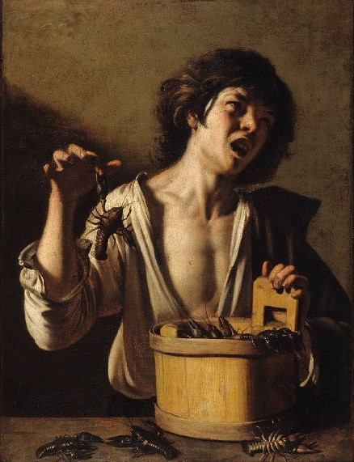

# Caravaggio and the Crab

<i>A short story</i>

2026-10-23

<i>Pictured is the Strasbourg </i>Boy Bitten by a Crayfish<i>, supposedly a copy of a lost Caravaggio work made by an anonymous follower of his sometime after 1593</i>

Thrill finds everyone, some way or another. The arbiters of the forces that be penetrate all of time and all of space, weaving the lives of their subjects.

## Prologue

Like an artist without a discipline, like a hill without a precipice:
I walk the ridge every day in awe of the foggy greatness just outside my small home. Wind whips brownish tall grasses, and sometimes just docily brushes them. Sometimes all of the grass just stands upright, unperturbed. The mornings when I walk which fog covers everything, such that you cannot see below the ridge where settlement lies, or anywhere higher either: an expanse that is limited yet not uncoverable. The walk is a wander and a basking-in. There is little visible to set destination to, nor much novel at any corner, and yet the brownish tall grasses and the fog bring joy. I feel I find myself the same place inside as out.

## 1. The Descent

The humors comprise Blood, the Yellow, the Black, and Phlegm. Phlegm, Margot says, is what I have too much of. She comes in:  
&nbsp;&nbsp;&nbsp;&nbsp;"Markus, yesterday I went down to the port and bought from a merchant this wonderful paintbrush. You have forty-eight days unil I expect the Holy Geist to come down upon you, reinvoke your passions, and you to have used it."
She places the wooden utensil on my desk and exits. Yesterday was Easter and only the third Easter I have spent outside of the company of my mother. She thinks I have that great disease, consumption, and has put me to waste away in this shack at the top of the hill outside of town, passively hoping the sunlight or the gentle winds will bring me back to life. This has been the case for the whole past winter, and now, the spring. My colleagues, or rivals, no longer communicate. Two months ago saw the last letter Margot relayed to me from Janus, stating his plans to journey to Rome and learn anatomy from the statues there. Everyone thought I would be going to Rome around now. The greatest baroque prodigy of the Duchy, they said. But last autumn I went on a trip. I went on a nice and decent trip, traveling east. And when I got back, I was no more painterly, no more capable of portrayal. Now I sit, I think, and my hand has lost its path.  
&nbsp;&nbsp;&nbsp;&nbsp;The Phlegm, my maid Margot says, is too prolific in relation to the other three Humors. It is held in my lungs, which my mother thinks are being eaten by that great disease. Previous patrons of mine, who have conspired with the women to fund this long sabatical, create their own theories as well. Many think that, due to my youthful brashness and licentious proclivities, I consumed some eastern product that has imbibed my lungs with harm. The truth is, I may have had some seasonal ailment many months ago, but now, I feel perfectly fine.  
&nbsp;&nbsp;&nbsp;&nbsp;Yes, my body is young and in a healthful state. As for my lapse in creation, I suppose my former patrons are the most accurate. I realize I should tell you, the reader, the truth after all. That way, instead of hiding behind opinion, I can at least have attempted to accomplish something.  
&nbsp;&nbsp;&nbsp;&nbsp;I tell you, I have already lied: the trip that was my fall, in which I said goodbye to my countrymen and told them I would travel east to the Crown of Hungary, for leisure and to explore architecture there, was a farce. Instead, I went south. I am still not sure if it was a mistake. Really, I travelled south with the aim of Neapolis, to where I heard Caravaggio had recently fled. I would find him and beg to be his student, or at least find myself among his followers. He is where my problems started. Before I saw any of his work I had heard of the great Italian who created Reality, that his paintings ceased to be pictures or representations, but were so powerful that they were real things themselves. When I saw one of his pieces at a lavish exhibition, for which I am forever indebted to the sponsorship of my patron Alessandro, I was struck. I spent months trying to recreate the style, all of my production from this time netting only ridicule and made tossed aside. Despite its lack of reception the need to follow this thread would not leave. For a time, I hid my obsession and built my reputation, until last year, when I decided it was time to set off on my own. With only fate as my guide, the journey did not go to plan. I knew that the language of people would become insurmountably different as I went further south. I knew their dress and customs would change, too. But not this much. As I ventured further and further the changes became increasingly radical. Once I had crossed the mountains accompanied by a small band of mysterious folk, draped in brightly painted, thin material, I arrived in a penninsula undescribable. I remember everything being incredibly bright past dusk, extreme contrasts of light and dark, the constructs of Caravaggio showing themselves. My travelling comrades bounded into a structure of armor, which flew them away. When I passed through Rome it was unlike any city I could even dream of while sleeping. I do not bother telling anyone about this experience, for lack of my words, and lack of their ability to understand or believe me. It would be much more instrumental to present the manuscript of my friend David, whom I met there. He says that he comes from the New World and is some sort of smith, a noble craft. Thank God for Guttenberg. The text is on my desk, right under the brush Margot just gave me. Though she would notice nothing but a populated canvas.

## 2. A Collation of Entries Relating to Giasper's

### November 9, 2026

Hamilton, the reporter friend known through Monica, was telling us last night, at my third dinner party, about his time last year at the mysterious Giasper's. I'm lucky this intruiging anecdote of his stuck in my mind after it was plentily bathed in Syrah, and so today I write it at once:  
&nbsp;&nbsp;&nbsp;&nbsp;It was winter of last year, the time when Giasper's is serving. Hamilton was creating a piece for the "Anglo Sensibilities" section of the <i>Neue Genfer Zeit</i>. After mailing the required entry sum to Giasper's Treasury, an address only God knows how he obtained, he was taken from his hotel. It was about a week since his posting, a Friday, ripe for a feast. Men broke in, blinded his eyes and took him onto a bus full of others. He regained sight after being walked off the bus into what seemed like an airplane. He says that the ride to Giasper's is famously nauseating.  
&nbsp;&nbsp;&nbsp;&nbsp;After the transportation, Hamilton's story gets blurry: in my mind, at least, and likely in the details he offered. But what I remember quite clearly he said was that he thought the experience wasn't worth the rave praise it receives. He said he can eat plenty good seafood on land, and didn't care for the company of brahmins and their perverted actions at the dining tables.  
&nbsp;&nbsp;&nbsp;&nbsp;This was the first I'd heard of Giasper's, though Monica acted as if it was old news. It wasn't news at all, though, since Giasper's staff caught wind of Hamilton's opinions and paid him to be quiet.
Knowledge of this place seems limited to those who know things before the news, before the general public, before the word gets out: the reporters, the fashionable, and the wealthy. But now I know about it. Perhaps I'm now fashionable. And so I write this down. It's these kinds of things that make me await the next dinner party.

### November 17, 2026

Business is running at the bicycle foundry. Winter season. Giftcycle season. I hope these bikes spin longer than three months.
Sally came down to the brazing floor. She never interrupts my work. I knew she had a reason:  
&nbsp;&nbsp;&nbsp;&nbsp;"David, do you have a minute? ... I'm so sorry, but someone just came by and told me your mother is dead." Weird how I heard it, but yeah, that's the news.  
&nbsp;&nbsp;&nbsp;&nbsp;Three notes Sally relayed, I assume from my uncle: (1) mom had money for me, (2) the bank is taking the money if they find out about it, (3) obviously, the bank is taking her house.

### November 19, 2026

I feel bad about not seeing her in a while. I would've, if I'd known about it. Everyone would've. She would've called me if she knew. A blind cancer like a coat of snow suffocates you while you can't even feel it. It's like a therapy session that I write this. Shrink page, shrink pen: I'm shrinking into them, like somebody's hearing me, at least.

### November 30, 2026

Antonio, uncle, slips me an envelope at the collation. The collation at Rod's Deli, just into New Hampshire. It's a sleepy family: me, him, mom's friends from Montreal came down. <i>Il se souviennent</i>.  
&nbsp;&nbsp;&nbsp;&nbsp;Lucky he kept in touch with her. Lucky he kept her amiable. I wish I did. I would've. Lived too far. And still, I would've, if anyone'd known.  
&nbsp;&nbsp;&nbsp;&nbsp;I knew about her gambling problems, her mortgage problems, but I didn't know about ten thousand dollars. Lucky he did. No one else can.  
&nbsp;&nbsp;&nbsp;&nbsp;At Rod's I took the stuffed squid. It got me thinking. A thinking food. Scissoring through rubber bulbs to where you think squid's brain would be. A real thinking food.

### December 4, 2026

Dinner party number four. Makes sense it's on the fourth. I made braised pork. Homophonous with much of my occupation. No one thought it was much funny. Well, they were mostly sad once I told them about my mother. I told Hamilton the best thing he could do was give me the address of Giasper's Treasury.  
&nbsp;&nbsp;&nbsp;&nbsp;"Can you really afford that?"  
&nbsp;&nbsp;&nbsp;&nbsp;"I'll see what I can do."  
&nbsp;&nbsp;&nbsp;&nbsp;"Like I said, it's really not worth it, and of course, the address changes every season." But he couldn't offend the bereaved: "I'll see what I can do."

### December 13, 2026

Hamilton calls me as I'm on the brazing floor.  
&nbsp;&nbsp;&nbsp;&nbsp;"...of course, you'll have to mail from locally in Naples... The dinner costs $5,000." I thought about a fattened envelope at home and eased his concerns about my ability and readiness, and the worthiness of the endeavor.  
&nbsp;&nbsp;&nbsp;&nbsp;"I need to do it. I just need a change of pace." I asked Sally for my vacation time this holiday.  

### December 30, 2026

My flight to Italy two days ago went smoothly, and yet I encountered turbulence upon landing. Besides giving a fateful parcel to the post, the past two days were filled with excessive sleep, unguided walks in an attempt to either curb or play out the overthinking of <i>the right thing to be doing</i>, and after-dinner espressi that maybe either a wiser or more ignorant me would point to as the cause of it all. Now I write on what I can sense in my soul to be the night before dining (for why else would tonight's events have happened), and all that shakiness has ceased. Not because of some quality of the precipice I teeter on, but because of a man I met a few hours ago. I met him in the bar underneath my hotel. We bonded over the fact that we both couldn't speak Italian and could speak German. But language barriers weren't the primary cause of his isolation in the bar:  
&nbsp;&nbsp;&nbsp;&nbsp;I didn't realize until we were well into conversation that he was some sort of bum. I hadn't noticed his tattered clothes, slight identifiable stench, or bag of bottles. Of course, we kept talking after I did. His face is that of a boy's; my heart aches for him. Mark is his name. Some of what he said made little sense to me, and yet he spoke with more humanity than most. He said he can't work because no one knows where Caravaggio went, and that he can't return home because he'd have to tell his mother of his suffering. I gave him the best advice I could, to tell his mother of his suffering, as I wish mine had to me.  
&nbsp;&nbsp;&nbsp;&nbsp;This anecdote, of her cancer, somehow struck a chord with him. His tone changed. I really made him puzzled. I puzzled myself, too. What happened next is hard to rationalize in words, but it is what has now made me comfortable. I have become convinced our journeys are aligned, and I convinced him to join me to Giasper's tomorrow morning. He sleeps on the floor of my room as I write. When they come to fetch me, so long as there is the space, they surely wouldn't mind Mark coming along in exchange for the rest of my money. I hope, at least. Now I've bankrupted myself, but I've given everything more purpose.

### January 2, 2027

The object we seek, Thrill, makes itself known in a way that is difficult to know: surprise, that is. They come in the night and rise us. I am stripped of belongings, made blind, and bound. This means, of course, I could not bring a pen, a notebook: I write this in the afterglow, hurriedly while I still remember. Thankfully, my friend is included in the constrainment after not words but gesticulation between us and subsequent monetary capitulation. They guide us down the stairs, out the door, and onto what feels like a bus full of others. No one speaks but I can sense a sea of anxiety.  
&nbsp;&nbsp;&nbsp;&nbsp;The binds and the blinding get removed, after that initial transportation, while on something like a jet bridge. The cohort is finalized and freed, relatively, on the bridge, and we walk on to the final vehicle decidely without any glimpse outside.  
&nbsp;&nbsp;&nbsp;&nbsp;"Welcome to the plunger. Please take your seats and buckle as we will descend shortly," the loudspeaker repeats in Italian and English. As we sit down I peer around. I am finally able to get a look at my company for today's feast. Many are well-kept, wealthy internationals. Some, obvious Romans. Some are more bitten-into people, looking like they reside on the edge of things. The staff, directing the flow of folks down the central aisle are neatly sartorial-clad: dark woolen material with red and gold stripes forms their perfect silhouettes. They are men and women with neatly-done, coarse dark hair and olive skin. The seats are similar to their dress, red with purple stripes. I am next to the wall with a covered inlet of a window, my friend to my right. The man next to him, in lederhosen, offers:  
&nbsp;&nbsp;&nbsp;&nbsp;"This can't possibly hold anything to the food in Tirol." The person next to that man, next to the aisle, wearing something with many buttons:  
&nbsp;&nbsp;&nbsp;&nbsp;"No, no, it will dispel any earthly attachments to foods, truly ruining," implying she regularly makes the plunge.  
&nbsp;&nbsp;&nbsp;&nbsp;After a period of chatter, building a suspenseful attitude among us all, the staff gives a loud, verbal "hush!" Everyone quiets and there is a lurch forward with which we start moving and the cabin lighting becomes dim. After a few minutes the window next to me and all of those along the side of the vessel open in a synchronized clatter. A wave of "ahh"s come out through the cabin followed by another "hush," and "please respect the solace sought in this moment by all of our comradery." While there had been a rolling sensation of the vehicle along the ground, we soon experience a slight lift, after which spotlights start to shine downward from above each seating position. They indicate our attention to the floor, which then exposes a glass window under which the portion of the chasis making up the bottom of the vessel recedes to the sides with a final clatter. We are thereby exposed to the sights of the Sea.  
&nbsp;&nbsp;&nbsp;&nbsp;We buzz above the continental shelf. People talk, though now more cautious than before. Any daylight that had gleamed through the water with the crack of dawn starts to recede to the depths. The spotlights penetrate a haze and we find that we quickly pass by meadows of seagrass, colorful coralligenous assemblages. The folks behind us point out a rare monk seal, who swims along the vessel, peering inside with a look of maybe curiousity or disgust and then quickly darts away. After a period that felt close to two hours we approach the shelf's escarpment, which presents a steep drop into black. The vehicle decelerates to a gentle hover and we hear:  
&nbsp;&nbsp;&nbsp;&nbsp;"We will now ensure all buckles are fastened, as the plunge is imminent." They yank on the regular's, the Tirolean's, Mark's, then mine: all taut. With concerned body language they advise us to each take hold of a small bag from the seatback in front of us, the regular's already grasped.  
&nbsp;&nbsp;&nbsp;&nbsp;"The plunge proceeds." The whole of the fuselage careens to a harrowing declination of sixty degrees, the belt pressing hard into my waist as we hang forward. The lighting goes black and black is all around. We hear the windows shut but it makes little difference. Then the whirring and subsequent exploding; a grand, grand ripping forth and the pressure, the pressure, and once it ceases, it allows the vomit it agitated about but had suspended against the backs of our esophagi to come forth. Anything we had consumed on land above exits, our stomachs cleansed anew. We plunge down thousands of meters in a few minutes. After vomiting, suddenly, like nothing had happened, we ride flat and smooth once again.  
&nbsp;&nbsp;&nbsp;&nbsp;"We now approach our destination, cruising above the plain of the Tyrrhenian Basin at a depression of circa 4,000 meters below sea level." The windows open, letting us look out. What I see is the seafloor like snow, black pervaded by a quiet blanket of white. A lone surface-scraping creature perturbs the blanket, camouflaged in sand as it drifts about. Just when it starts to seem acceptable to conceive of this voyage as a great error, that there is nothing here for us, that the plunger will falter, that we will be crushed by the depths and our bones will suffice as an obstacle for some kind of skate or eel, a glimmer of light appears on the horizon.  
&nbsp;&nbsp;&nbsp;&nbsp;"Now you may gaze upon the dome, upon Giasper's, upon our venue for dining. Today is special, as the first feast of the year of our lord two thousand and twenty-seven, a prime number, we add; may your experience be similarly unfactorable, irradicable, and pleasant." It comes into view with hundreds of three-meter tall triangular glass windows linteled by beams of shining titanium: geodesic and hardy. A hydrothermal vent behind it provides the sustaining murmur for this nonsensical operation. The dome slowly extends a telescopic bridge from its singular stoma, and couples with the plunger.  
&nbsp;&nbsp;&nbsp;&nbsp;As we deplane, a thought plays through my head. <i>The wise man builds his house on the rock; the foolish man builds his house on the sand.</i> In the bridge, while we pass by, staff offer spritzes of perfume to dull the acrid scent of puke. The doorman shakes each of our hands. He speaks in a voice that is astonishingly less sinister and more familiar than any of the other staff's.  
&nbsp;&nbsp;&nbsp;&nbsp;"Welcome to Giasper's. We catch everyfish ourselves."

### January 2, 2026, continued

Mark rose as I was writing earlier and we went out for espresso and a simple meal. Everyone I've heard from has told me that Naples is a dirty city with people just as crude. I can't accept that; I've been to Giasper's. The city is just fine. It's human. Mark already seems to betray a heightened courage amidst the trash on the street and for that I am proud. We return to the hotel and rest, comforted by dry wooden walls. I resume from memory:  
&nbsp;&nbsp;&nbsp;&nbsp;A massive chandelier looms over. Even though they burn our precious oxygen, candles are on the tables. The tables are round and evenly spaced throughout, suffocated by a dark purplish-brown cotton tablecloth with a gently contrasting Arabesque, or perhaps merely psychedelic, patterning in its weave. Each table is surrounded by eight modernist wooden chairs. The kitchen, a half-as-large windowless dome connects at a tangent on the side by the hydrothermal vent, accessible through a pair of swinging, batwing doors that leave just enough space above and below to let the despair and the agony of the cooks slip out.  
&nbsp;&nbsp;&nbsp;&nbsp;The staff show us to assigned seats. The organization of the party is based in an intentional, yet opaque-to-us strategy. Graciously, I am seated across from Mark. The waiters that were already inside, standing still at symmetrical posts, put out their musing cigarettes. Service begins promptly.  
&nbsp;&nbsp;&nbsp;&nbsp;I cannot begin to describe the fare. If I must, we start with apertivo: resplendent charcuterie consisting in Zwieback with the roe of Dofleini's lantern fish, dusted with verbena, plumped over thin, layered slices of cured tuna belly and other fatty cuts of mysterious fish. These stacks crowd large oval dishes placed center-table for us to gather onto the small circular plates in front of us. Placed next to the plates are bulbs of kelp-spirit vermouth with reef-grown botanicals. The drink is dark to the eyes but bright on the palate. In this attempt, I overflow with words. For each course, I have in my mind many, if not more than double the words I just wrote, but I can't quite enact them correctly. At a minimum of double more is the size of the shadow of my experience which I can't decide on in language. These sentences barely convey:  
&nbsp;&nbsp;&nbsp;&nbsp;Next comes Swordfish ceviche dressed with Sorrentine acidity.
Steaming braisers overflowing with tentacles escape the kitchen grasped by woolen mitts.
Enameled bowls are liberally placed for the disposal of shells.
More drink: highballs of whiskey from those same kelp-spirit driftwood barrels.  
&nbsp;&nbsp;&nbsp;&nbsp;They instruct us on which of the creatures come from near the mouth at Gibraltar, or that at Gallipoli, and what of our feast comes from the nearby undersea peak of Marsili. They instruct us on those creatures that are demersal and those pelagic. A small trio starts up in what would be a corner (an arc?): brushed snare, upright bass, and a sax resembling a cephalopod. Mark and I have each lived recent chapters of isolation, and now, conversation engages:  
&nbsp;&nbsp;&nbsp;&nbsp;"The other day my father died, but I never really liked him." Esmerelda next to me is Portuguese, and won't touch the stew because it's not her vovó's, but relishes in everything else. It feels like a relevant impasse but I don't think I can directly respond to her. I change the subject:  
&nbsp;&nbsp;&nbsp;&nbsp;"Have you ever eaten squid ink ravioli before?"  
&nbsp;&nbsp;&nbsp;&nbsp;"Of course. They serve it every New Year's. But this one feels special. It's a prime number!"
From the other side of the table Mark takes small, slow bites, unsure of anything he's witnessing. I can't tell if he's still nauseated from the plunge or is like this from the food. I remember feeling proud of him.  
&nbsp;&nbsp;&nbsp;&nbsp;"How are you enjoying it?" I ask.  
&nbsp;&nbsp;&nbsp;&nbsp;"Mhm, mhm, I cannot believe how artistic it is." He said something like that. Outside, tripodfish, planted on the sandy floor, stalk us through the windows of the dome. Down here the name of every creature seems to end in "fish." As thosefish that eat fish where fish must be, wefish also seem to be fish. A German man two placings clockwise from me, who had not spoke previously, interrupts:  
&nbsp;&nbsp;&nbsp;&nbsp;"Which penis do youfish desire? We must come to consensus as a table." I don't know how to respond. Mark gives me a nervous look. Esmerelda sees this glimpse of fear from us and starts to giggle. Just then, the staff:  
&nbsp;&nbsp;&nbsp;&nbsp;"And now, we give you choice <i>alla carta</i>." Handouts of rough, thick paper are distributed, titled <i>indice fallacia</i> in clean serif. It is a list comprising the five (a prime number, I add) baleen whales that can be found in the Mediterranean:

* Humpback whale penis.
* Fin whale penis.
* Grey whale penis.
* Minke whale penis.
* Sei whale penis.

<i>All cooked for 96 hours, served in their own sauce.</i>

Before we can decide on a phallus, like a Quaker meeting, an Italian at another table stands up: he announces loudly, to the whole party:  
&nbsp;&nbsp;&nbsp;&nbsp;"Ifish, whom some may know as Bishop, may surprise you by saying that I have a confession to make: above in the Holy See there is no good food, and that is why I must plunge to the depths of the worldly Sea, where nofish can stop me from tasting pleasure. Let usfish rejoice and toast to this: wefish are free fish!" Hefish guzzles the rest of his drink and sits back down. With his chair still pushed out, exposed for everyfish to see, he undoes his trousers and begins to touch fishself. After bringing our glasses together and guzzling in tow, everything began to twist into a haze. Somefish from across the room glares a needy glare and blows a kiss at me. The last thing I remember after all the penises came out is the staff serving the crab.  
&nbsp;&nbsp;&nbsp;&nbsp;Twisted is the word for it. The haze affects me now, still in the afterglow: my body sore as I write laying down. Mark sleeps.

### January 6, 2027

It's the eve of my departure. Mark prepares to leave soon as well. Today, when he asked exactly what had transpired, I tell Mark that this is cancer: to eat only the grossly extravagant, do anything for it, and travel to the bottom of the Sea for the same sustenance that simple folk fulfill with barley and farro. Misery led to Purposelessness and so cancer, the Crab, is what we eat. I had to eat cancer to know cancer. I thought I knew what was in store, planned for it to be, and yet the nature of Thrill is that you cannot brace for the traumament. The reason I did it is because I thought it'd bring me closer to my mother.  
&nbsp;&nbsp;&nbsp;&nbsp;The reason Shelby did it is because she doesn't eat anything but Giasper's, once a month.
The reason Giusseppe did it is because he thinks it's more ethical than trawl-caught fish.
The reason Gunther von Konstanz did it is because a woman he fancies, Esmerelda, does it every now and then.
The reason Bishop Garibaldi did it is because he feels the Church is under too much scrutiny nowadays.
The reason Esmerelda did it is for the taste and the texture.
The reason Hamilton did it is to write a story and get paid.
The reason Markus von Hinterland did it is to experience Reality. Do any suffice?  
&nbsp;&nbsp;&nbsp;&nbsp;I thought it'd bring me closer to my mother and I'm not sure if that happened. It would've if I'd known. Though in a way, it did: Thrill twists at both ends. Now I go back to bikes and must keep on spinning true, as if I never was twisted.  
&nbsp;&nbsp;&nbsp;&nbsp;I type up a copy of these journal entries for Mark to take back with him to Westfalen, to help him work through it all, as I still do.

## 3. The Return

This is my final walk outside of the shack. I walk by brownish tall grasses, through fog, and down the hill, in an act of deserting: deserting the paintbrush on the table, deserting that old home itself. I spent so much time reading that printed manuscript. I read it almost every day. Today, after my last recollection, I finally act on what I knew for a long time: I need to talk to my mother, show her my clear skin and the lack of hoarseness in my voice, explain where I was and who I am. I must tell her the truth, that I have not consumption but cancer, the problem of the Crab.  
&nbsp;&nbsp;&nbsp;&nbsp;I ruminate as I uncover, step by step:  
&nbsp;&nbsp;&nbsp;&nbsp;In the past month I made a few charcoal sketches of the dome and the plunger, but they do not feel like art. Evidently, neither do they to Margot, who would not believe I am recovered until I produce a true painting. The sketches are not artistic to me; rather, they are more like a map, a practical creation as an attempt to physically jog my memory of those times. Jog it to what end I do not exactly know, except that I feel the only thing that seems to hold real value lies in my mind somewhere near there. Upon this consideration of my sketching it occurs to me that this sounds like a description of art. But no, the sketches do not feel like art. The sketches are hollow and slightly disgusting, though their creation seemed necessary in order to get at something possibly like art.  
&nbsp;&nbsp;&nbsp;&nbsp;I see now why all of my elders wanted me not to pursue Caravaggio. After what transpired I have thrown into question all of what is real and true. But I am still not sure if I am any worse off. I do not know if I can produce art but I do know that I am still an artist: at the very least I can eat.
